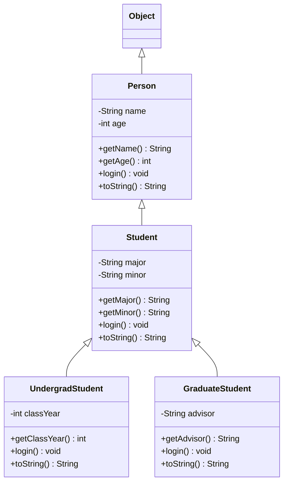

# L17: Inheritance Example

In-class example on inheritance in Java: subclasses, `super(...)` constructor calls, inherited getters, and overriding methods while still running the superclass version with `super.login()`.

## Class diagram



Each subclass overrides `login()` and calls `super.login()` first: Logging in as an `UndergradStudent` invokes `Person.login()`, then `Student.login()`, then `UndergradStudent.login()`.

## Run

```sh
javac -d bin src/*.java
java -cp bin Main
```
